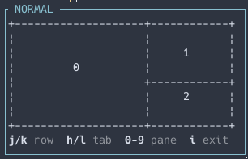

# herdr-navigation-mode

A vim-like navigation mode for the [Herdr](https://herdr.dev) sidebar. Press a key
to enter the mode, then walk the sidebar with `j` and `k`, the tabs with `h` and
`l`, and jump to a pane by its number on a little map of the tab — every step
moves Herdr's focus too, so you browse by looking at the panes themselves rather
than at a list of names.

Spaces and agents are one continuous list: keep pressing `j` past the last
space and the cursor carries on into the agents section.

## Why not `prefix+g`

Herdr already has a Goto picker on `prefix+g`: an overlay with a search field,
every workspace, tab and pane in one list, filters for what the agents are
doing, and `enter` to switch. When you know the name of what you want, that is
the thing to reach for, and this plugin does not try to replace it.

This is for when you do not know. Nothing here is confirmed: every keystroke
moves Herdr's focus for real, so you decide by looking at the pane itself, at
full size and in its own place, rather than at its name and a line of detail in
a list. And the mode stays open, so the next candidate is one more keystroke
instead of another `prefix+g`.

## Install

Requires the Rust toolchain (`cargo`).

```bash
herdr plugin install svallory/herdr-navigation-mode
```

## Keybinding

Add to `~/.config/herdr/config.toml`:

```toml
[[keys.command]]
key = "prefix+space"
type = "shell"
command = "herdr plugin pane open --plugin navigation-mode --entrypoint navigate"
description = "navigation mode"
```

`prefix+esc` is the binding you would reach for first, and `herdr config check`
accepts it — but it never fires. Herdr's prefix mode treats Esc as "cancel the
prefix" and returns before it looks at custom commands, so the binding is dead
on arrival. Pick anything but Esc.

Then reload:

```bash
herdr server reload-config
```

## Usage

Press `prefix+space` to enter navigation mode — with `prefix = "ctrl+t"` that is
`ctrl+t` then `space`. A small popup appears with a map of the tab's panes and
one row of keys, and nothing else:



That the mode is on is said by the popup's own title, so nothing inside it has
to say so. The keys are drawn the way herdr draws its own prefix bar — each key
bright against a dim description.

The map is the pane layout of the tab the cursor is in, scaled into the popup.
Press a digit and the focus jumps to that pane, the way `display-panes` works
in tmux. Panes are numbered in the order Herdr lists them, and only the first
ten are numbered — there is no eleventh key to press.

The popup says nothing about which row you are on, and nothing about which pane
you are in. It does not have to: every move shifts Herdr's own focus, so the
sidebar highlights the current row, the tab bar highlights the tab, and the
focused pane's own border says which one it is.

- `j` moves down the sidebar, `k` moves up; both wrap around at the ends
- `l` goes to the next tab, `h` to the previous one; these wrap too
- `0` to `9` jump to that pane of the tab on the map
- Focus follows the cursor immediately — the pane behind the popup changes as
  you move
- The cursor starts on whatever had focus when you entered the mode
- `i` or `Enter` leaves the mode (`Ctrl+C` also works), and the focus stays
  wherever you left it

`h` and `l` walk the tabs of whichever workspace the cursor is in — its own
tabs when the cursor is on a space, the tabs of the workspace it lives in when
the cursor is on an agent. They start from the tab that workspace was already
showing, and a workspace with a single tab has nowhere to step, so nothing
happens.

Stepping a tab moves the focus off the row the cursor is on, and it stays
there: the cursor is not dragged along, and leaving the mode does not pull the
focus back.

The lists are read once when the mode opens and are not refreshed while it is
open, so a space, agent or tab that appears in the meantime shows up the next
time you enter. The map is the exception: it is read again whenever the tab you
are on changes, because that is a different tab's shape rather than a change to
one we already have.

The popup is a fixed size, because Herdr sizes a popup when it opens it and
offers no way to resize one. So the map fills the same box whether the tab holds
one pane or nine. The rows are laid out against the size the pane reports rather
than the size the manifest asks for: the keys take the last row the pane really
has, and the map fills what is left above them.

There is no error line. If herdr does not answer, or the terminal refuses to
give up raw mode, the popup simply closes again — the failure would have to be
reported on the very thing that failed, and it goes away with the popup either
way.

## Local development

```bash
herdr plugin link /path/to/herdr-navigation-mode
cargo test
cargo build --release
```

The plugin talks to Herdr over its socket (`$HERDR_SOCKET_PATH`), not through
the `herdr` CLI. That is not a preference: focusing a pane by id is only offered
as an API method, since `herdr pane focus` moves by direction. Note that the
server answers one request per connection and then closes it, so each call
opens its own — a second write on the same stream gets a broken pipe.

With `plugin link` the pane still runs the release binary, so rebuild after
editing. To iterate without rebuilding by hand, change the pane command in
`herdr-plugin.toml` to `["cargo", "run", "--release", "--quiet"]`.
